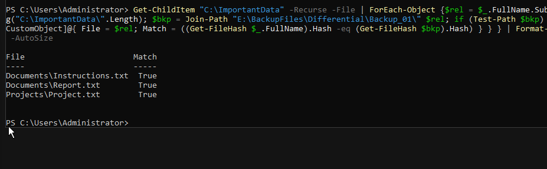

# Резервное копирование и восстановление данных в Windows Server 2025

## 1. О проекте

В данном проекте рассмотрена настройка резервного копирования и восстановление данных в Windows Server 2025 Standard Evaluation.

В ходе лабораторной работы реализованы три типа резервного копирования:

- **Full Backup** — полное резервное копирование.
- **Incremental Backup** — инкрементное резервное копирование.
- **Differential Backup** — дифференциальное резервное копирование.

Для выполнения операций использовались PowerShell и Robocopy.

Основная задача проекта — показать не только создание резервных копий, но и порядок восстановления данных из них.

## 2. Подготовка виртуального сервера

### 2.1. Установка Windows Server 2025

Для выполнения лабораторной работы была создана виртуальная машина в Oracle VirtualBox с операционной системой Windows Server 2025 Standard Evaluation.


### 2.2. Проверка дисков

Перед началом работы необходимо проверить доступные диски и убедиться, что система видит дополнительный накопитель для хранения резервных копий.

Для проверки используется команда:

```powershell
Get-Disk
```


### 2.3. Создание и форматирование диска

Для хранения резервных копий был подготовлен отдельный диск с файловой системой NTFS и меткой BACKUP.

После подготовки диск доступен как `E:`.


### 2.4. Установка компонента резервного копирования

На сервере был подготовлен компонент, необходимый для работы с резервным копированием.


## 3. Подготовка исходных данных

Для проверки работы резервного копирования был создан каталог:

```text
C:\ImportantData
```

В нём находятся тестовые файлы:

```text
ImportantData
├── Documents
│   ├── Instructions.txt
│   └── Report.txt
└── Projects
    └── Project.txt
```


Резервные копии будут храниться на диске `E:` в каталоге:

```text
E:\BackupFiles
```

## 4. Полное резервное копирование (Full Backup)

Полное резервное копирование создаёт копию всех файлов из исходного каталога.

Для выполнения используется команда:

```powershell
robocopy "C:\ImportantData" "E:\BackupFiles\Full" /E /COPY:DAT /R:2 /W:2 /TEE
```

Описание параметров:

- `/E` — копирует все подкаталоги, включая пустые.
- `/COPY:DAT` — копирует данные, атрибуты и время изменения файлов.
- `/R:2` — количество повторных попыток при ошибке.
- `/W:2` — время ожидания между попытками в секундах.
- `/TEE` — выводит результат в консоль.

После выполнения команды в каталоге `E:\BackupFiles\Full` находятся все исходные файлы.


## 5. Инкрементное резервное копирование (Incremental Backup)

Инкрементное резервное копирование позволяет копировать файлы, которые были изменены после предыдущего резервного копирования.

В данной лабораторной работе для определения изменённых файлов использовался атрибут Archive.

Сначала атрибут Archive был сброшен:

```powershell
attrib -A C:\ImportantData\* /S
```

Затем были изменены два файла:

```powershell
Add-Content "C:\ImportantData\Documents\Instructions.txt" "Incremental backup second test"

Add-Content "C:\ImportantData\Projects\Project.txt" "Incremental backup second test"
```

После изменения у файлов появился атрибут Archive.

Для копирования используется команда:

```powershell
robocopy "C:\ImportantData" "E:\BackupFiles\Incremental\Backup_01" /E /M /COPY:DAT /R:2 /W:2 /TEE
```

Параметр `/M` копирует файлы с установленным атрибутом Archive и сбрасывает этот атрибут после успешного копирования.

Таким образом, в инкрементную копию попадают изменённые файлы.


## 6. Дифференциальное резервное копирование (Differential Backup)

Дифференциальное резервное копирование сохраняет изменения относительно полной резервной копии.

В данной лабораторной работе оно реализовано следующим образом.

Сначала создаётся копия полной резервной копии:

```powershell
robocopy "E:\BackupFiles\Full" "E:\BackupFiles\Differential\Backup_01" /E /COPY:DAT /R:2 /W:2
```

Затем в неё добавляются более новые версии файлов из исходного каталога:

```powershell
robocopy "C:\ImportantData" "E:\BackupFiles\Differential\Backup_01" /E /XO /COPY:DAT /R:2 /W:2 /TEE
```

Параметр `/XO` исключает файлы из источника, которые старше файлов в каталоге назначения.

В результате каталог Differential содержит полную базу и актуальные версии изменённых файлов.


## 7. Проверка целостности резервных копий

Для проверки целостности данных используется алгоритм SHA256.

Он позволяет сравнить содержимое исходных файлов и файлов резервной копии.

Пример проверки:

```powershell
Get-FileHash "C:\ImportantData\Documents\Instructions.txt" -Algorithm SHA256
```

Для сравнения исходного файла с файлом из дифференциальной копии:

```powershell
Get-FileHash "C:\ImportantData\Documents\Instructions.txt" -Algorithm SHA256

Get-FileHash "E:\BackupFiles\Differential\Backup_01\Documents\Instructions.txt" -Algorithm SHA256
```

Если значения Hash совпадают, содержимое файлов идентично.

В ходе работы были проверены все три исходных файла. Результат сравнения показал совпадение SHA256.



## 8. Восстановление данных из резервных копий

Восстановление данных — один из важнейших этапов резервного копирования.

Ниже приведены команды, позволяющие вернуть файлы из созданных резервных копий.

### 8.1. Восстановление полной копии (Full Restore)

Для восстановления полной копии используется команда:

```powershell
robocopy "E:\BackupFiles\Full" "C:\RestoreTest\Full" /E /COPY:DAT /R:2 /W:2 /TEE
```

После выполнения команды все файлы из полной резервной копии будут скопированы в каталог восстановления.

Проверить восстановленные файлы можно командой:

```powershell
Get-ChildItem "C:\RestoreTest\Full" -Recurse
```


### 8.2. Восстановление инкрементной копии (Incremental Restore)

Для восстановления инкрементной копии необходимо сначала восстановить полную копию, а затем последовательно применить все инкрементные копии в порядке их создания.

Сначала восстанавливаем полную копию:

```powershell
robocopy "E:\BackupFiles\Full" "C:\RestoreTest\Incremental" /E /COPY:DAT /R:2 /W:2
```

Затем применяем первую инкрементную копию:

```powershell
robocopy "E:\BackupFiles\Incremental\Backup_01" "C:\RestoreTest\Incremental" /E /COPY:DAT /R:2 /W:2
```

Если создано несколько инкрементных копий, их необходимо применять последовательно: Backup_01, Backup_02 и далее.

### 8.3. Восстановление дифференциальной копии (Differential Restore)

Для восстановления дифференциальной копии сначала восстанавливается полная копия, а затем последняя дифференциальная копия.

Сначала восстанавливаем Full:

```powershell
robocopy "E:\BackupFiles\Full" "C:\RestoreTest\Differential" /E /COPY:DAT /R:2 /W:2
```

Затем применяем Differential:

```powershell
robocopy "E:\BackupFiles\Differential\Backup_01" "C:\RestoreTest\Differential" /E /COPY:DAT /R:2 /W:2
```

В нашей реализации каталог Differential уже содержит полную базу и актуальные версии изменённых файлов.

## 9. Результаты лабораторной работы

В ходе выполнения проекта:

- Подготовлена виртуальная машина с Windows Server 2025.
- Подготовлен отдельный диск для хранения резервных копий.
- Создан каталог с исходными данными.
- Реализовано полное резервное копирование.
- Реализовано инкрементное резервное копирование.
- Реализовано дифференциальное резервное копирование.
- Выполнено восстановление из полной резервной копии.
- Проверена целостность файлов с помощью SHA256.
- Подтверждено совпадение хешей исходных файлов и файлов дифференциальной копии.

## 10. Заключение

В результате лабораторной работы были изучены три способа резервного копирования данных в Windows Server 2025.

Были рассмотрены особенности каждого способа, команды создания резервных копий и порядок восстановления информации.

Работа показала, что резервное копирование является важной частью защиты данных, а регулярная проверка восстановления позволяет убедиться в работоспособности созданных копий.

Для автоматизации операций использовались PowerShell и Robocopy, а для проверки целостности — SHA256.
