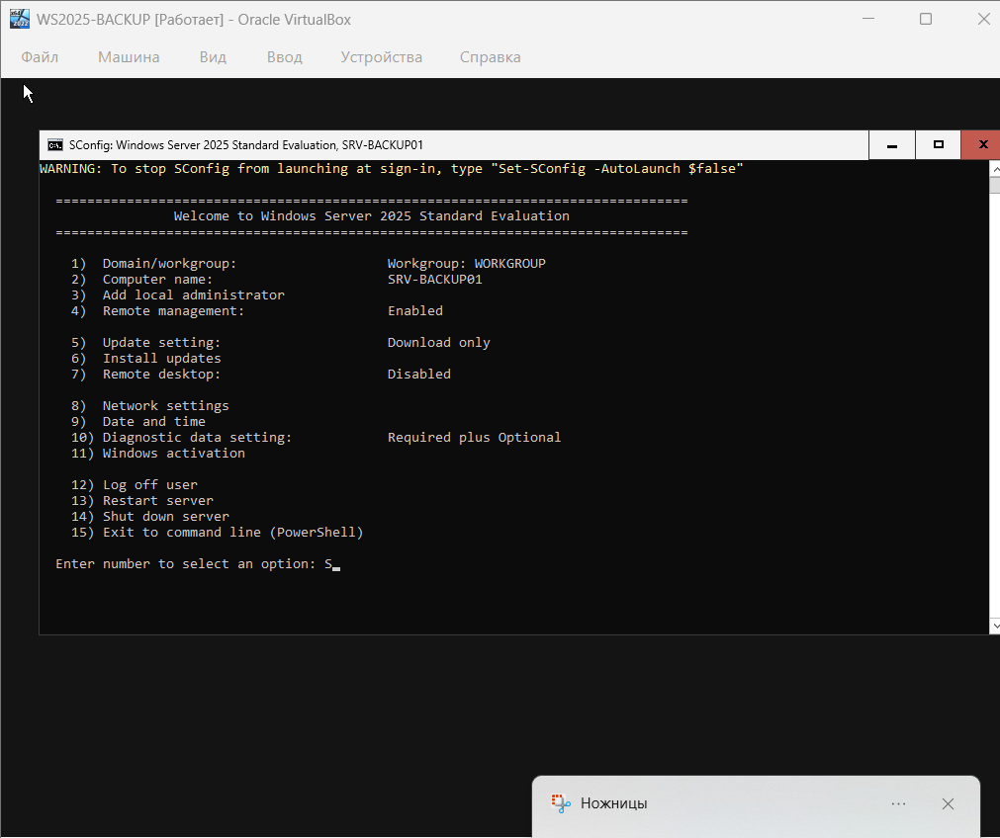
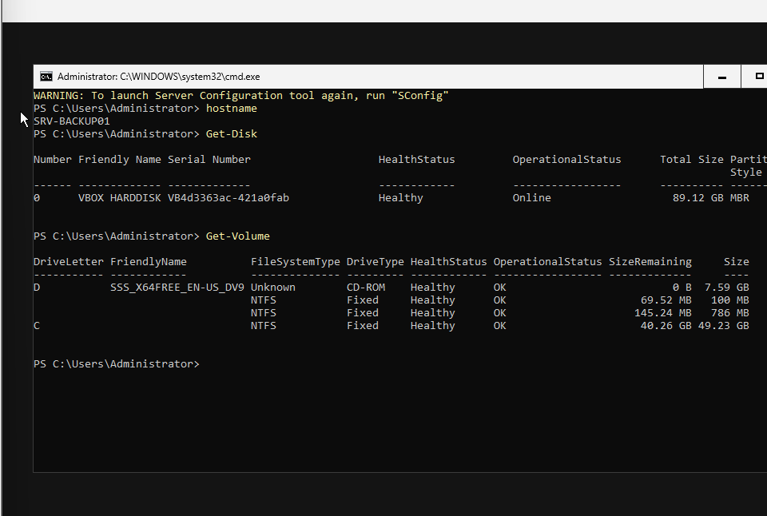
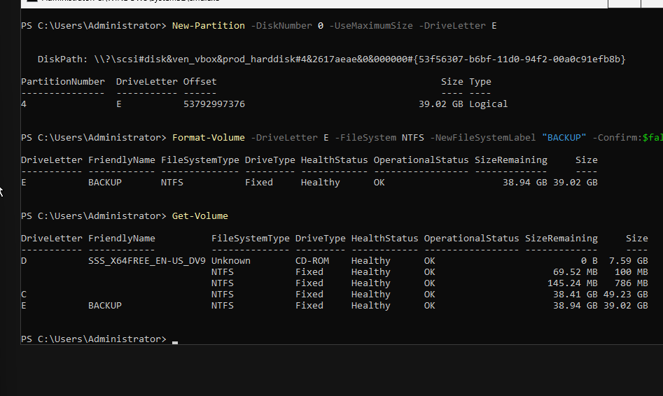
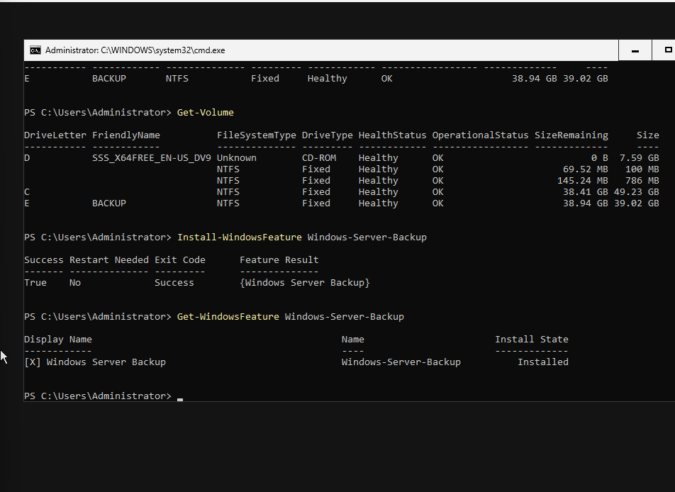
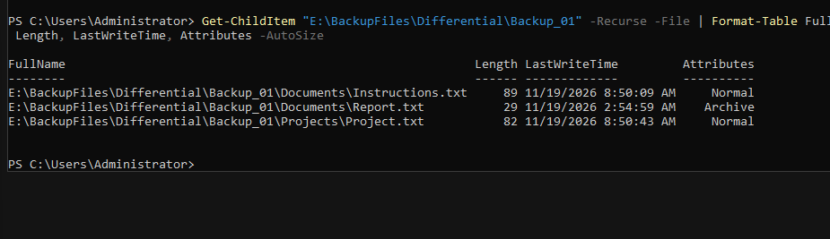

# Лабораторная работа: Резервное копирование в Windows Server 2025

## 1. Описание проекта

Данный проект представляет собой лабораторную работу по настройке и реализации трёх типов резервного копирования в операционной системе Windows Server 2025.

В ходе работы были реализованы:
- Полное резервное копирование (Full Backup).
- Инкрементное резервное копирование (Incremental Backup).
- Дифференциальное резервное копирование (Differential Backup).

Для реализации использовались PowerShell и встроенная утилита Robocopy.

Виртуальная среда была развёрнута с помощью Oracle VirtualBox.

## 2. Используемая среда

| Компонент | Конфигурация |
|---|---|
| Виртуализация | Oracle VirtualBox |
| Операционная система | Windows Server 2025 Standard Evaluation |
| Сборка ОС | 26100 |
| Имя сервера | SRV-BACKUP01 |
| Файловая система | NTFS |
| Исходные данные | C:\ImportantData |
| Хранилище резервных копий | E:\BackupFiles |
| Том для бэкапов | E: (BACKUP) |

## 3. Подготовка среды

Был создан отдельный том E: объёмом 39,02 ГБ с файловой системой NTFS.

Для хранения резервных копий создан каталог:

`E:\BackupFiles`

Исходные данные расположены в:

`C:\ImportantData`

Структура исходных данных:

```text
C:\ImportantData\
├── Documents\
│   ├── Instructions.txt
│   └── Report.txt
└── Projects\
    └── Project.txt
```

Все три исходных файла первоначально имели атрибут Archive.

## 4. Полное резервное копирование (Full Backup)

Полное резервное копирование предполагает копирование всех исходных файлов и каталогов независимо от того, изменялись они или нет.

Команда:

```powershell
robocopy "C:\ImportantData" "E:\BackupFiles\Full" /E /COPY:DAT /R:2 /W:2 /TEE
```

Используемые параметры:

- `/E` — копирование всех подкаталогов, включая пустые.
- `/COPY:DAT` — копирование данных, атрибутов и временных меток.
- `/R:2` — две повторные попытки при ошибке.
- `/W:2` — ожидание две секунды между попытками.
- `/TEE` — вывод результатов в консоль.

Результат: все три исходных файла успешно скопированы в отдельный каталог Full.

## 5. Инкрементное резервное копирование (Incremental Backup)

Инкрементное копирование позволяет сохранять только файлы, которые изменились после предыдущей точки резервирования.

В данной лабораторной работе использовался атрибут Archive.

Перед экспериментом Archive bit был сброшен после создания полной резервной копии. Затем были изменены два файла:

- Documents\Instructions.txt
- Projects\Project.txt

Команды изменения файлов:

```powershell
Add-Content "C:\ImportantData\Documents\Instructions.txt" "Incremental backup test"

Add-Content "C:\ImportantData\Projects\Project.txt" "Incremental backup test"
```

Команда резервного копирования:

```powershell
robocopy "C:\ImportantData" "E:\BackupFiles\Incremental\Backup_01" /E /M /COPY:DAT /R:2 /W:2 /TEE
```

Параметр `/M` выполняет копирование файлов с установленным Archive bit и сбрасывает этот атрибут после успешного копирования.

Результат: в инкрементную копию попали два изменённых файла.

Для восстановления такой копии необходимо сначала восстановить Full Backup, а затем применить Incremental Backup.

## 6. Дифференциальное резервное копирование (Differential Backup)

Дифференциальное копирование сохраняет изменения относительно последней полной резервной копии.

В данной лабораторной работе использовалась базовая копия Full и сравнение временных меток файлов.

Сначала создаётся базовая копия:

```powershell
robocopy "E:\BackupFiles\Full" "E:\BackupFiles\Differential\Backup_01" /E /COPY:DAT /R:2 /W:2
```

Затем в неё копируются более новые версии исходных файлов:

```powershell
robocopy "C:\ImportantData" "E:\BackupFiles\Differential\Backup_01" /E /XO /COPY:DAT /R:2 /W:2 /TEE
```

Параметр `/XO` исключает файлы из источника, которые старше файлов назначения.

Результат: дифференциальная копия содержит полный базовый набор данных и обновлённые версии двух изменённых файлов.

В отличие от инкрементного метода, дифференциальная копия сохраняет базовую версию и последние изменения в одном наборе.

## 7. Проверка целостности данных (SHA256)

Для проверки корректности резервного копирования использовался алгоритм SHA256.

Пример команды:

```powershell
Get-FileHash "C:\ImportantData\Documents\Instructions.txt" -Algorithm SHA256
```

Контрольные суммы исходных файлов сравнивались с контрольными суммами файлов в дифференциальной резервной копии.

Результат проверки:

- Instructions.txt — True
- Report.txt — True
- Project.txt — True

Все три файла успешно прошли проверку целостности.

## 8. Восстановление данных (Full Restoration)

Для проверки восстановления была создана отдельная тестовая директория:

`C:\RestoreTest\Full`

Команда восстановления:

```powershell
robocopy "E:\BackupFiles\Full" "C:\RestoreTest\Full" /E /COPY:DAT /R:2 /W:2 /TEE
```

После восстановления были проверены:
- Наличие всех трёх файлов.
- Сохранение структуры каталогов.
- Соответствие размеров файлов.
- Контрольные суммы SHA256.

Восстановление полной резервной копии прошло успешно.

## 9. Структура резервного хранилища

```text
E:\BackupFiles\
├── Full\
│   ├── Documents\
│   └── Projects\
│
├── Incremental\
│   └── Backup_01\
│
└── Differential\
    └── Backup_01\
```

## 10. Скриншоты выполнения

### 10.1. Установка и подготовка Windows Server









### 10.2. Подготовка исходных данных


### 10.3. Реализация резервного копирования




### 10.4. Проверка и восстановление


## 11. Заключение

В ходе лабораторной работы была подготовлена виртуальная среда Windows Server 2025 и реализованы три метода резервного копирования с использованием PowerShell и Robocopy.

Были изучены принципы работы полного, инкрементного и дифференциального резервирования, управление атрибутом Archive, проверка целостности данных с помощью SHA256 и процедура восстановления файлов.

Работоспособность полной резервной копии была подтверждена успешным тестовым восстановлением.

Проект демонстрирует практическое применение инструментов резервного копирования в среде Windows Server.
