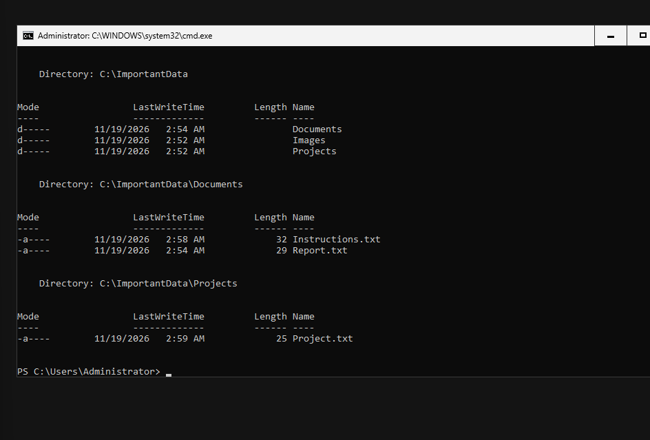
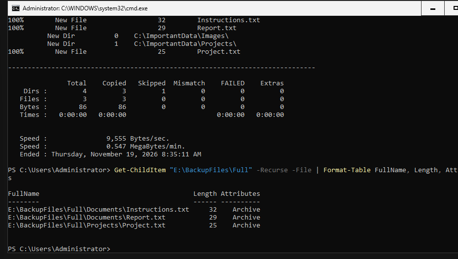
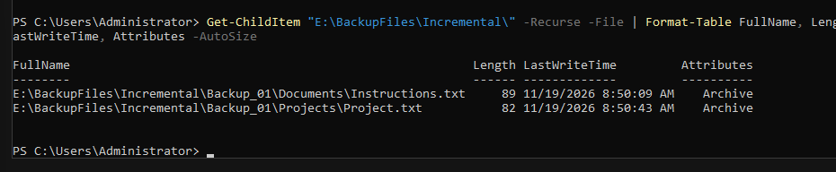
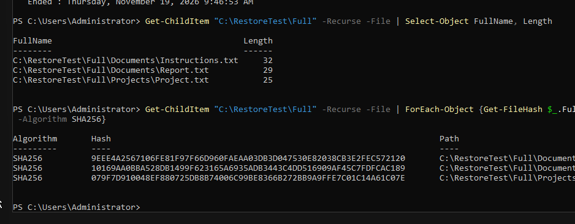

# Windows Server 2025 — Backup Lab

## Описание проекта

В этом лабораторном проекте показана настройка резервного копирования на **Windows Server 2025 Standard Evaluation** с использованием трёх подходов:

- **Full Backup** — полное резервное копирование.
- **Incremental Backup** — инкрементальное резервное копирование.
- **Differential Backup** — дифференциальное резервное копирование.

Для выполнения лабораторной работы использовались PowerShell и Robocopy.

## 1. Используемая среда

- ОС: Windows Server 2025 Standard Evaluation
- Виртуальная машина: Oracle VirtualBox
- Имя сервера: `SRV-BACKUP01`
- Исходные данные: `C:\ImportantData`
- Диск для резервных копий: `E:\BackupFiles`

## 2. Подготовка сервера

Устанавливаем Windows Server 2025 и выполняем первоначальную настройку системы.


Проверяем доступные диски и убеждаемся, что дополнительный диск подключён.


Создаём раздел на дополнительном диске, форматируем его в NTFS и присваиваем метку `BACKUP`.


Устанавливаем необходимую роль Windows Server Backup через Server Manager.


## 3. Создание исходных данных

Создаём папку `C:\ImportantData` и тестовые файлы:

```text
C:\ImportantData
├── Documents
│   ├── Instructions.txt
│   └── Report.txt
└── Projects
    └── Project.txt
```

Эти файлы будут использоваться для проверки резервного копирования и восстановления.



Создаём папку для хранения резервных копий:

```powershell
New-Item -Path "E:\BackupFiles" -ItemType Directory -Force
```

## 4. Full Backup — полное резервное копирование

Полная резервная копия содержит все исходные файлы.

Выполняем команду:

```powershell
robocopy "C:\ImportantData" "E:\BackupFiles\Full" /E /COPY:DAT /R:2 /W:2 /TEE
```

Параметры:
- `/E` — копирование всех папок, включая пустые.
- `/COPY:DAT` — копирование данных, атрибутов и времени изменения.
- `/R:2` — две повторные попытки при ошибке.
- `/W:2` — ожидание две секунды между попытками.
- `/TEE` — вывод результата в консоль.



## 5. Incremental Backup — инкрементальное резервное копирование

Инкрементальная копия сохраняет файлы, которые изменились после предыдущего резервного копирования.

Сначала сбрасываем Archive-атрибут у исходных файлов:

```powershell
attrib -A C:\ImportantData\* /S
```

Изменяем несколько файлов:

```powershell
Add-Content "C:\ImportantData\Documents\Instructions.txt" "Incremental backup second test"

Add-Content "C:\ImportantData\Projects\Project.txt" "Incremental backup second test"
```

Создаём инкрементальную копию:

```powershell
robocopy "C:\ImportantData" "E:\BackupFiles\Incremental\Backup_01" /E /M /COPY:DAT /R:2 /W:2 /TEE
```

Параметр `/M` копирует файлы с установленным Archive-атрибутом и сбрасывает этот атрибут после успешного копирования.



## 6. Differential Backup — дифференциальное резервное копирование

Дифференциальная копия должна содержать изменения относительно первоначальной полной копии.

Сначала создаём базовую копию Full:

```powershell
robocopy "E:\BackupFiles\Full" "E:\BackupFiles\Differential\Backup_01" /E /COPY:DAT /R:2 /W:2
```

Затем добавляем в неё изменённые файлы из исходной папки:

```powershell
robocopy "C:\ImportantData" "E:\BackupFiles\Differential\Backup_01" /E /XO /COPY:DAT /R:2 /W:2 /TEE
```

Параметр `/XO` пропускает файлы, которые старше файлов в папке назначения. Таким образом, в базовой копии обновляются более новые версии файлов.

В результате папка Differential содержит исходные файлы Full и актуальные версии изменённых файлов.


## 7. Проверка целостности файлов

Для проверки используем алгоритм SHA256.

Пример команды для исходного файла:

```powershell
Get-FileHash "C:\ImportantData\Documents\Instructions.txt" -Algorithm SHA256
```

Сравниваем хеши исходных файлов и файлов в дифференциальной копии.

Совпадение SHA256 означает, что содержимое соответствующих файлов идентично.


## 8. Проверка восстановления Full Backup

Проверяем восстановление полной резервной копии в отдельную папку:

```powershell
robocopy "E:\BackupFiles\Full" "C:\RestoreTest\Full" /E /COPY:DAT /R:2 /W:2 /TEE
```

После выполнения проверяем наличие восстановленных папок и файлов.



В лабораторной работе было проверено восстановление Full Backup. Восстановление Incremental и Differential описано ниже как инструкция для самостоятельной проверки.

## 9. Скачать готовые резервные копии

Для удобства подготовлен ZIP-архив со всеми тремя вариантами резервного копирования.

**[Скачать Windows-Server-Backups.zip](backups/Windows-Server-Backups.zip)**

После скачивания распакуйте архив. Внутри находятся папки:

```text
Windows-Server-Backups
├── Full
├── Incremental
│   └── Backup_01
└── Differential
    └── Backup_01
```

## 10. Как восстановить файлы из ZIP-архива

### Шаг 1. Распаковать архив

Например, если ZIP-файл находится в папке Downloads, откройте PowerShell и выполните:

```powershell
Expand-Archive -Path "$env:USERPROFILE\Downloads\Windows-Server-Backups.zip" -DestinationPath "C:\BackupRestore" -Force
```

### Шаг 2. Восстановить Full Backup

```powershell
robocopy "C:\BackupRestore\Full" "C:\RestoredData\Full" /E /COPY:DAT /R:2 /W:2
```

В папке `C:\RestoredData\Full` появятся файлы из полной резервной копии.

### Шаг 3. Восстановить Incremental Backup

Сначала необходимо восстановить полную копию:

```powershell
robocopy "C:\BackupRestore\Full" "C:\RestoredData\Incremental" /E /COPY:DAT /R:2 /W:2
```

Затем применить инкрементальную копию поверх полной:

```powershell
robocopy "C:\BackupRestore\Incremental\Backup_01" "C:\RestoredData\Incremental" /E /COPY:DAT /R:2 /W:2
```

В результате получится набор файлов с учётом изменений из Incremental Backup.

### Шаг 4. Восстановить Differential Backup

Сначала восстанавливаем полную копию:

```powershell
robocopy "C:\BackupRestore\Full" "C:\RestoredData\Differential" /E /COPY:DAT /R:2 /W:2
```

Затем применяем дифференциальную копию:

```powershell
robocopy "C:\BackupRestore\Differential\Backup_01" "C:\RestoredData\Differential" /E /COPY:DAT /R:2 /W:2
```

В результате получится набор файлов с учётом изменений из Differential Backup.

> Важно: для восстановления Incremental и Differential сначала требуется Full Backup. Приведённые команды рассчитаны на структуру папок из приложенного ZIP-архива.

## 11. Итог

В ходе лабораторной работы были выполнены:

- Подготовка Windows Server 2025.
- Подключение и настройка диска для резервных копий.
- Создание исходных тестовых данных.
- Полное резервное копирование (Full).
- Инкрементальное резервное копирование (Incremental).
- Дифференциальное резервное копирование (Differential).
- Проверка целостности файлов с помощью SHA256.
- Проверка восстановления полной резервной копии.
- Подготовка ZIP-архива с резервными копиями и инструкции по восстановлению.

Проект демонстрирует базовые принципы резервного копирования и восстановления данных в Windows Server 2025.
